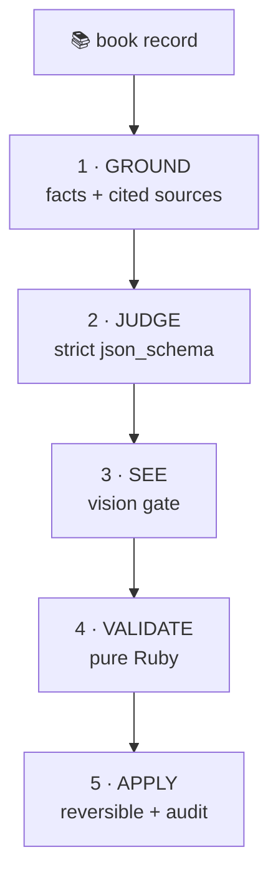
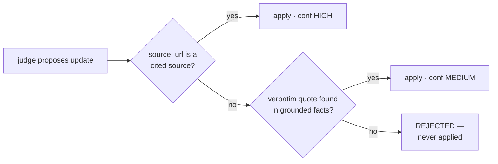

## The problem

Litloop — an OS for book clubs (Amharic + English) — had rules-based metadata only:

- *"The Alchemist"* filed under **Business & Economics**
- no country of origin at all
- English descriptions for an Amharic book club
- covers = unsplash placeholders, randomly low-res

Google Books / Open Library are thin for Ethiopian titles.

**Goal:** improve book metadata with AI — grounded, sourced, reversible.

---

## What we built

One Rails pipeline where **every AI call flows through the Otari gateway** —
one virtual key, open-weight models by default:

```
books table ──▶ GROUND ──▶ JUDGE ──▶ SEE ──▶ VALIDATE ──▶ APPLY ──▶ audit
```

- gateway-run **web search**, **code execution**, **MCP servers**
- strict **structured outputs**, **Files API** vision
- Ruby-side gates — **no model output is trusted**
- every write reversible: originals + provenance in an audit JSON

---

## Architecture



*every box has its own slide — nothing is trusted, everything is gated*

---

## Ground & Judge — cite, or it doesn't count

- **GROUND**: books MCP + gateway web search → facts, each with a source URL
- **JUDGE**: one strict-schema call decides per field:

```json
{ "country_of_origin": {
    "action": "update", "value": "Nigeria",
    "source_url": "https://en.wikipedia.org/wiki/Things_Fall_Apart",
    "quote": "1958 novel by Nigerian author Chinua Achebe" } }
```

- the judge may only update **when it cites — never from memory alone**

---

## Cite-gates — confidence is mechanical



- unattributed claims **never reach the database**

---

## Covers — the LLM looks, Ruby decides

- stored image bytes → Otari **Files API** → vision model:
  *real cover? matches the title (even in Amharic glyphs)? resolution?*
- candidate tiers: judge-cited → Wikipedia → Open Library → page mining
- only **vision-verified** bytes swap the cover

And yes — it once put **'Into the Wild'** on *Things Fall Apart* 😅
caught by the vision gate, fixed by tier order + filters.

---

## Live results

| book | before | after |
|---|---|---|
| ኦሮማይ (Oromay) | placeholder + wrong cover scan | real cover via cited URL, vision-gated |
| የተቆለፈበት ቁልፍ (Amharic) | unsplash placeholder | real Amharic cover found |
| So Long a Letter | empty description | **HIGH** via books MCP + real OL cover |
| Things Fall Apart | wrong book's cover ('Into the Wild') | cited cover, vision-verified |
| መኃለየ መኃልይ (Amharic) | no description, no country | Amharic desc + `ET`, both HIGH |

Good data is kept too — Sapiens/Alchemist judgments: **no churn**.

---

## Literature DNA — code execution as a feature

Each club gets a **Literature DNA** dashboard generated by AI:

- model reads the club's reads, reviews, attendance → writes **matplotlib code**
- code runs in **Otari's sandbox** (`otari_code_execution`) —
  charts come back as files attached to the reply
- panels: attendance bars, weekday donuts, genre treemap, difficulty curve,
  discussion-question clusters
- admin audit view shows the **sandbox code + stdout** — proof, not vibes

```
club data ──▶ gpt-oss-120b writes python ──▶ otari sandbox ──▶ 📊 charts
```

---

## Budgets — every call is metered

- `OtariUsage` ledger: **every** chat, search, vision, sandbox call
  attributed to a user + feature
- **per-user monthly quota** (default 5 runs = DNA generation or enrichment),
  enforced app-side; admins exempt
- usage + cost per model visible live in the Otari dashboard

```
gpt-oss-120b : 23 calls   $ 0.0042
deepseek-vl  :  9 calls   $ 0.0011
                      ────────────
                total       $ 0.0053
```

---

## Day 2 — the books MCP server

A **self-hosted books MCP server** (Cloudflare Worker): Google Books +
Open Library + Project Gutenberg, deduplicated by ISBN, cached 7 days.

- registered once in the Otari dashboard: purpose hint + tool allowlist
- the gateway runs the tool loop — the app just sends:

```ruby
client.chat(..., mcp_server_ids: [ENV["OTARI_MCP_BOOK_SERVER_ID"]])
```

- grounding now **prefers MCP lookups** — exact records by ISBN where
  web search returned 646-byte fact piles

---

## Honest tradeoffs

- Goodreads CDN compresses covers (~26 KB) — correctness > max resolution
- inline `image_url` silently dropped by open-weight VL models —
  Files API is the working path (docs need it)
- obscure Amharic titles can still hit the registry blank spot
- hosted fee is small but real — self-hosting is the escape hatch

---

## Submission checklist

- **Repo:** `nebiyuelias1/litloop` · branch `feat/club-literature-dna`
  · **PR #137 → `otari-hackthon`**
- **First Otari commit:** `c197ee1` — "add Otari AI gateway client service"
- **Otari features used:** chat completions · structured outputs · gateway-run
  web search · **code execution** · Files API vision · **workspace MCP
  servers** · **budgets + usage**
- **Tests:** 320 runs, 1402 assertions, 0 failures
- **Demo path:** admin enrich button → books 2471/2472 before/after →
  audit JSON walk → club DNA charts → budget dashboard

---

## Thanks / Try it

- Litloop: `github.com/nebiyuelias1/litloop` — PR #137
- Books MCP: `github.com/projectahi/books-mcp` — free Cloudflare Worker
- Otari: `otari.ai` · `github.com/mozilla-ai/otari`
- Star the repo, ping me on the Discord — and bring an Amharic book!

```
   ▄▄▄▄▄▄▄  the library finally
   █ █▄▄▄▄█  knows where its books
   █ █▄▄▄▄█  come from  🇪🇹 📚
```
