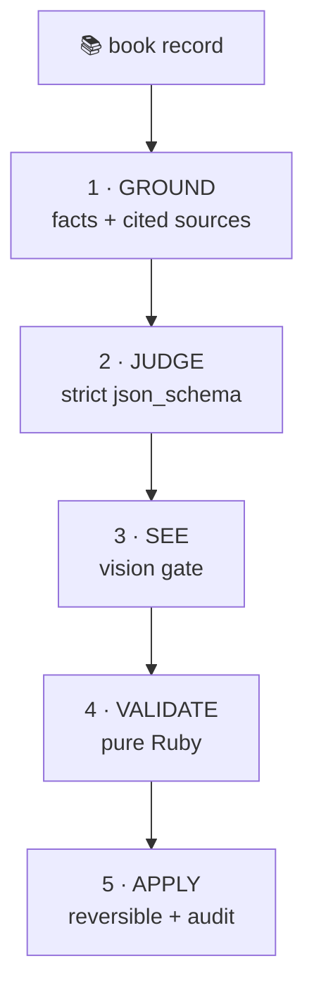
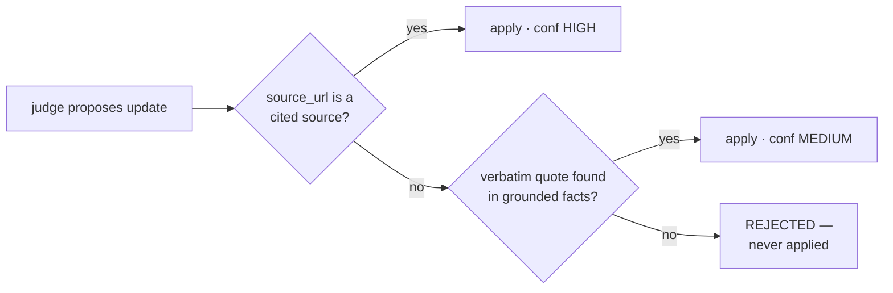
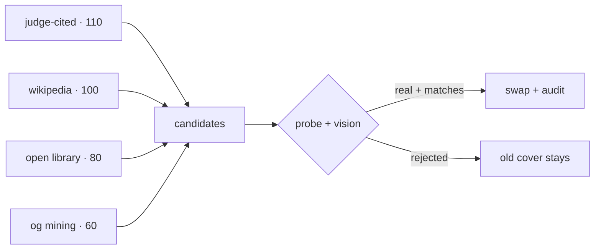

## The problem

Litloop (book-club app, Amharic + English library) had rules-based metadata only.

- Category junk: *"The Alchemist" → "Business & Economics"*
- No country-of-origin at all
- Descriptions in English for an Amharic book club
- Covers = generic unsplash placeholders, randomly low-res
- Google Books / Open Library are thin for Ethiopian titles

**Goal:** improve book metadata with AI — grounded, sourced, reversible.

Run: `presenterm presentation.md` — the three flowcharts use `+render` and turn into real

diagrams live (mmdc/mermaid-cli 12.2.0 already installed).

---

## What we built

A Rails-side enrichment pipeline where **every model call flows through one
Otari gateway endpoint** (hosted otari.ai, one virtual key):

- open-weight models by default, frontier escalation when needed
- gateway-run web search, structured outputs, Files-API vision
- Ruby-side verification — **no model output is trusted, everything is gated**
- reversible writes: originals + provenance stored in an audit JSON

```
books table ──▶ GROUND ──▶ JUDGE ──▶ SEE ──▶ VALIDATE ──▶ APPLY ──▶ audit
```

Note: everything below = 4 stacked PRs on one hackathon branch.

---

## Architecture



*every box has its own slide — nothing is trusted, everything is gated*

---

## Otari setup — one key, many models

```bash
# .env — the app never touches provider keys directly
OTARI_BASE_URL=https://api.otari.ai/api/v1
OTARI_API_KEY=tk-...
```

- Hosted gateway 4.5% top-up fee on top-ups; first 200 signups got \$20 tokens
- `OtariClient.configured?` = single source of truth ("is the gateway set up?")
  - controllers pre-flight it for instant UX feedback
  - the background job re-checks it before doing work
- Models used:

| model | role | modality |
|---|---|---|
| `openai/gpt-oss-120b` | primary judge / summarizer (open weights) | text |
| `mistral/mistral-large-latest` | frontier escalation | text |
| `deepseek/deepseek-v4.1-flash-1017` | cover vision (open weights) | image→text |

---

## Phase 1 — GROUND (research before judging)

- One chat call to **gpt-oss-120b** with the gateway-run web-search tool:

```json
{ "tools": [{ "type": "otari_web_search", "max_uses": 3 }] }
```

- Model reports bullet facts, **each ending in a source URL**
- Ruby harvests the gateway tool-call trail (`otari_tool_calls`):

```
facts ──▶ cited sources   (URLs the facts actually reference)   ◀ trusted
tool trail ──▶ consulted sources (everything the search backend
                 read — incl. noise like "true-detective plot")   ◉ audited
```

- Amharic titles: prompt requests transliterated searches too
- Escalation: empty/timeout result → same call runs on `mistral-large`

---

## Phase 2 — JUDGE the old against the grounded

One **strict structured-output** call — per-field verdicts:

```json
{
  "description": { "action": "keep_existing", … },
  "country_of_origin": {
    "action": "update", "value": "Nigeria",
    "source_url": "https://en.wikipedia.org/wiki/Things_Fall_Apart",
    "quote": "1958 novel by Nigerian author Chinua Achebe" },
  "cover": { "judgment": "low_quality",
             "reason": "placeholder unsplash photo",
             "source_url": "https://i.gr-assets.com/…/18144590.jpg" }
}
```

- judge may only update when it cites — **never from memory alone**
- judge's own reason text may not contradict the vision verdict
  (a lesson learned: LLM once said "not a cover" and still scored "adequate")

---

## Cite-gates — confidence is mechanical



- whitelisted citation → high
- verbatim quote in the grounded facts → medium
- unattributed claim → **never reaches the database**

---

## Phase 3 — SEE (the LLM looks at the cover)

- Bytes of the **stored** cover → Otari **Files API** upload (multipart,
  `Otari-Key` header) → referenced as a `file` content block
- `deepseek-v4.1-flash-1017` answers three questions:

```
is_real_book_cover · depicts_title_match · quality(high/low res)
```

- Script-aware prompt: "the cover title may be in Amharic; judge by glyphs,
  transliteration (ኦሮማይ ⇄ Oromay), or the author name"
- Findings drive the **judgment enum**:

| vision says | judgment |
|---|---|
| real cover + matches + high_res | `adequate` (kept!) |
| placeholder / wrong book / low_res | `low_quality` (improver runs) |
| no image stored | `missing` |

---

## Phase 4 — VALIDATE (deterministic Ruby, zero LLM)

- country names → **ISO 3166-1 alpha-2** via a name→code map
  (model writes "Nigeria"; storage gets `NG`; model-invented names dropped)
- **Model-level validation too:** `Book#country_of_origin` inclusion check
- tags: lowercased, ≤6, ≤40 chars, reused via `find_or_create_by`
- description: length gate + provenance gate
- candidates: content-type `image/*`, 15 KiB–10 MiB,vision budget (max 3)

Everything is **reversible**: originals stored in `book.enrichment` JSON.

---

## Phase 5 — APPLY + audit (what the admin JSON shows)

```json
{
  "country_of_origin": { "action": "update", "value": "BR",
    "source_url": "en.wikipedia.org/wiki/Paulo_Coelho",
    "country_vision": "not_cover/low_res" },
  "cited_sources": ["somesite.com", "goodreads…"],
  "cover": { "old_cover": "images.unsplash.com/placeholder",
             "new_cover": "m.media-amazon.com/…/18144590.jpg",
             "vision_verdict": "real_cover/high_res", … }
}
```

- originals kept → every enrichment has an undo path
- UI: ✨ **AI-assisted** badge + "show previous description" toggle —
  **only shown when the rewrite actually differs**

---

## Cover replacement — cited source wins



- **cited_source is tier 110**: what the research named as the real cover
  beats a generic higher-tier guess — verified bytes still gate the swap
- Live case: ኦሮማይ cover came straight from a Goodreads/Amazon-CDN citation

---

## Escalation logic (my routing story)

```
open-weight first (gpt-oss-120b) ──ok──▶ use mine
        │ empty / declined / ReadTimeout(60s)
        ▼
frontier model (mistral-large) for that field only
        │ still nothing
        ▼
deterministic fallbacks (Wikipedia API, Open Library)
```

- case: gpt-oss refused country for "Dune" while Mistral answered
  `country + publisher evidence at high confidence`
- case: tool-loop 60s timeouts — grounding degrades to deterministic
  Wikipedia extract instead of failing the run

---

## Async admin UX

- Button → **SolidQueue job** → flash "queued — usually 1–2 minutes"
- tagged logs stream the whole run: `[enrich #79] [vision #79] [cover #79]`
- Otari dashboard shows every call + cost per model:

```
gpt-oss-120b : 23 calls   $ 0.0042
mistral-L    : 6 calls    $ 0.0190
deepseek-vl  : 9 calls    $ 0.0011
                             ───────
                     total      $ 0.0243
```

---

## Actual results (live books)

| book | before | after |
|---|---|---|
| ኦሮማይ (Oromay) | unsplash placeholder + wrong cover scan | **Goodreads cover via cited URL** + wiki author grounding |
| የተቆለፈበት ቁልፍ | unsplash placeholder | **real Amharic cover found** (ethiopiazare.com, vision-gated) |
| The Alchemist | unsplash placeholder | 25th-anniversary cover (cited Goodreads gr-assets) |
| Death of Vivek Oji | real but an Italian edition nearly tricked the gate | publisher CDN 1538×2400 exact cover |

- judge keeps good data too: Sapiens/Alchemist judgments = **kept, no churn**

---

## Why Otari earned the requirement

- **One endpoint, 40+ providers** — swapping open-weight ⇄ frontier is a
  model-id edit, not code
- **Gateway-run web search** with `max_uses` billing — no scraping in my app
- **Files API vision** for open-weight models that can't do inline image parts
- **Structured outputs** (strict json_schema) — fences for the judge
- **Budgets + usage dashboard** — every token attributed; 4.5% fee bought the
  observability I'd otherwise build myself

---

## Honest tradeoffs (for written feedback)

- Goodreads CDN compresses covers (26 KB) — correctness > max resolution
- Inline `image_url` **silently dropped** for open-weight VL models; the
  Files-API + `file` block + `Otari-Key` header is the working path — docs need it
- Some tool-loop runs came back with empty final content (fixed by judge-escalation)
- Obscure Amharic titles still can hit the registry blank spot — grounding
  fallback gets facts, but covers may not exist on the open web
- Hosted fee is small but real; self-hosting is the open-source escape hatch

---

## Day 2 — enter the books MCP server

A **self-hosted books MCP server** (Cloudflare Worker):
Google Books + Open Library + Project Gutenberg,
deduplicated by ISBN, cached 7 days.

- registered once in the Otari dashboard: purpose hint + tool allowlist
- the gateway runs the tool loop — the app just sends:

```ruby
client.chat(..., mcp_server_ids: [ENV["OTARI_MCP_BOOK_SERVER_ID"]])
# → search_books, get_book … all completed
```

---

## MCP-grounded enrichment

The old grounding starved the judge: *So Long a Letter* →
**646-byte fact pile** → description rejected **3×**.

Now:

- prompt says **prefer the MCP tools** — `get_book` by ISBN
- MCP outputs join the citation whitelist *(a real bug: they didn't)*
- a wrong `source_url` no longer vetoes a verbatim quote

Live: *So Long a Letter* description **HIGH** ·
**መኃለየ መኃልይ** → Amharic description + country `ET` **HIGH**

---

## Debugging the cover swap — three real bugs

| bug | fix |
|---|---|
| redirects never followed — OL pages `301` into silence, covers `302` to archive.org | follow redirects, log non-success |
| models annotate URLs → `URI must be ascii only` → all AI candidates died | extract the bare URL |
| Google Books cover URLs have no extension → judge-cited cover silently dropped | try cited URLs as direct images |

And once, the pipeline put **'Into the Wild'** on
*Things Fall Apart* 😅 — junk now filtered, budget 3→5.

---

## Day-2 live results

| book | before | after |
|---|---|---|
| So Long a Letter | empty description | **HIGH** via MCP + real OL cover |
| Things Fall Apart | wrong book's cover | cited cover, vision-verified |
| መኃለየ መኃልይ (Amharic) | no description, no country | Amharic desc + `ET`, both HIGH |

Plus `OtariBudget` metering and **320 tests green**.

---

## Submission checklist

- **Repo:** `nebiyuelias1/litloop` · **branch:** `feat/club-literature-dna`
  · **PR #137 → `otari-hackthon`**
- **First Otari commit:** `c197ee1` — "add Otari AI gateway client service"
- **Otari features:** chat completions · structured outputs · gateway-run web
  search · Files API vision · **workspace-scoped MCP servers** · budgets +
  usage dashboard
- **Tests:** 320 runs, 1402 assertions, 0 failures
- **Demo:** admin button → queued job → before/after books 75/76/79/85 +
  audit JSON walk; MCP: books 2471/2472 before/after
- **Feedback:** this deck, the log trace, the friction list above

---

## Thanks / Try it

- Litloop: `github.com/nebiyuelias1/litloop` — branch
  `feat/club-literature-dna` (PR #137)
- Books MCP: `github.com/projectahi/books-mcp` — self-hosted on a free
  Cloudflare Worker
- Otari: `otari.ai` · `github.com/mozilla-ai/otari`
- Star the repo, ping me on the Discord — and bring an Amharic book!

```
   ▄▄▄▄▄▄▄  the library finally
   █ █▄▄▄▄█  knows where its books
   █ █▄▄▄▄█  come from  🇪🇹 📚
```
