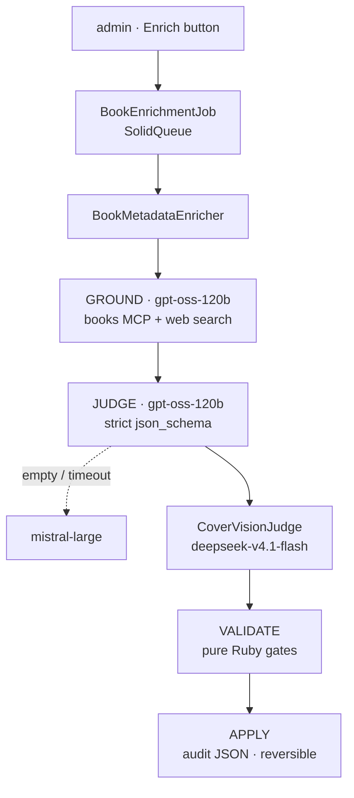
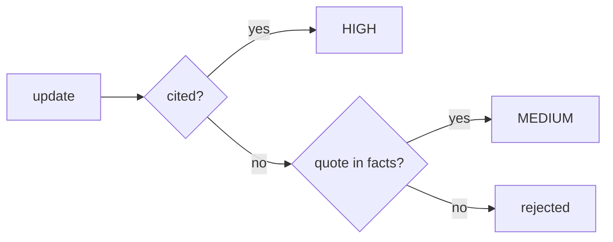
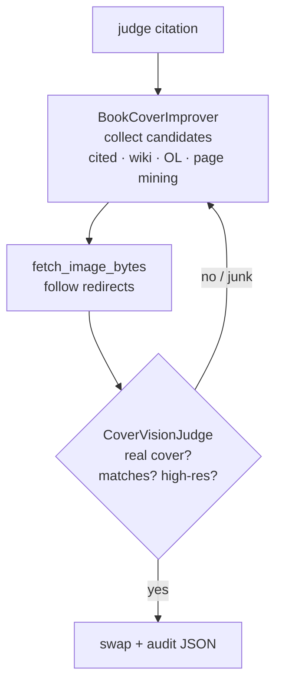
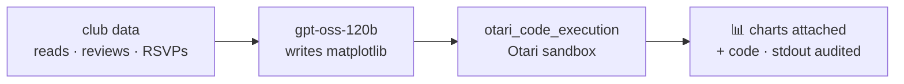

## The problem

Litloop — an OS for book clubs (Amharic + English) — had rules-based metadata only:

- *"The Alchemist"* filed under **Business & Economics**
- no country of origin at all
- English descriptions for an Amharic book club
- covers = unsplash placeholders, randomly low-res

Google Books / Open Library are thin for Ethiopian titles.

**Goal:** improve book metadata with AI — grounded, sourced, reversible.

---

## What we built

One Rails pipeline where **every AI call flows through the Otari gateway** —
one virtual key, open-weight models by default:

```
books table ──▶ GROUND ──▶ JUDGE ──▶ SEE ──▶ VALIDATE ──▶ APPLY ──▶ audit
```

- gateway-run **web search**, **code execution**, **MCP servers**
- strict **structured outputs**, **Files API** vision
- Ruby-side gates — **no model output is trusted**
- every write reversible: originals + provenance in an audit JSON

---

## The code behind the pipeline



*open weights first — frontier escalation only when the cheap path stalls*

---

## Cite-gates — confidence is mechanical



- unattributed claims **never reach the database**

---

## Covers — vision gates every swap



- bad candidates loop back until the vision budget runs out —
  only **verified** bytes touch the book

---

## Literature DNA — the sandbox draws the charts



- panels: attendance bars · weekday donuts · genre treemap · difficulty curve

---

## Budgets — every call is metered

- `OtariUsage` ledger: **every** chat, search, vision, sandbox call
  attributed to a user + feature
- **per-user monthly quota** (default 5 runs), enforced app-side;
  admins exempt
- usage + cost per model live in the Otari dashboard

```
gpt-oss-120b : 23 calls   $ 0.0042
deepseek-vl  :  9 calls   $ 0.0011
                ───────────────
          total          $ 0.0053
```

---

## Books MCP — exact grounding

A **self-hosted books MCP server** (Cloudflare Worker): Google Books +
Open Library + Project Gutenberg, deduplicated by ISBN, cached 7 days.

- registered once in the Otari dashboard: purpose hint + tool allowlist
- the gateway runs the tool loop — the app just sends:

```ruby
client.chat(..., mcp_server_ids: [ENV["OTARI_MCP_BOOK_SERVER_ID"]])
```

- grounding **prefers MCP lookups** — exact records by ISBN where
  web search returned 646-byte fact piles

---

## Thanks


**Neba** — 7+ years full-stack · Ethiopia 🇪🇹 → Taiwan 🇹🇼
ASUS · 508.dev · COSCUP 2026 speaker

- Litloop: `github.com/nebiyuelias1/litloop` — PR #137
- Books MCP: `github.com/projectahi/books-mcp`
- Otari: `otari.ai` · `github.com/mozilla-ai/otari`
- me: `github.com/nebiyuelias1` · `nebiyu@508.dev`
